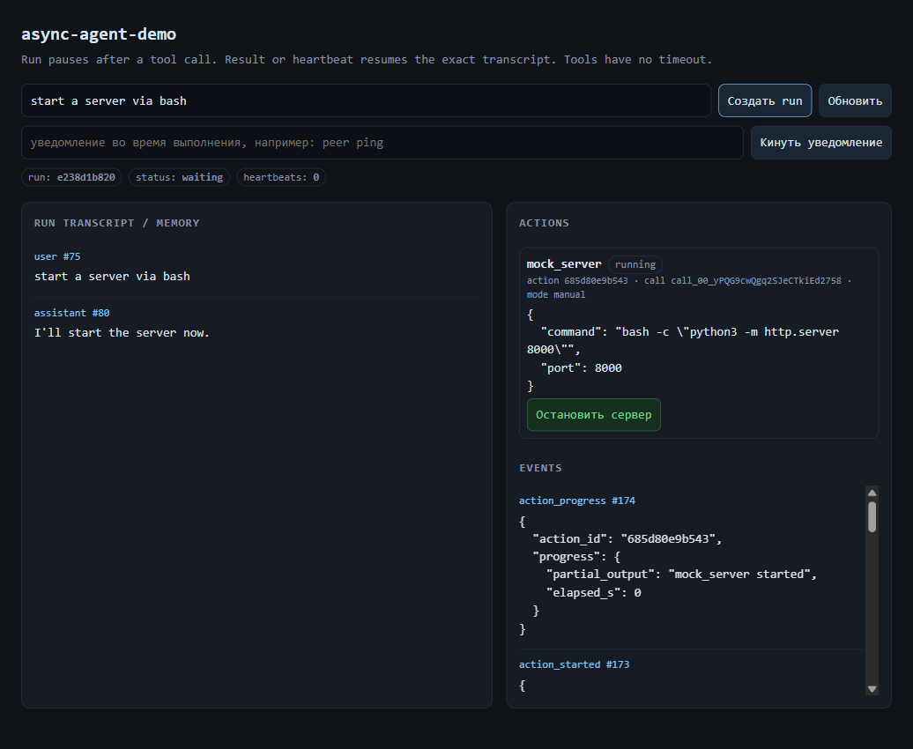

# async-agent-demo

Небольшая локальная демка, чтобы проверить **resumable generation** для агентов:

- агент вызывает инструмент и **перестаёт генерировать**;
- run сохраняет точный `messages` (включая `assistant.tool_calls`);
- результат инструмента **будит** run и продолжает тот же transcript;
- heartbeat будит run только при изменении progress/status, иначе backoff без LLM-вызова;
- у инструмента **нет таймаута**;
- память — append-only, без compaction;
- снаружи HTTP-запрос может ждать результата, но worker не блокируется на инструменте.

Это не production-код и не часть Nova. Задача — проверить механику и отрефайнить API.



Больше деталей:

- [Architecture and invariants](docs/architecture.md)
- [Benchmark](docs/benchmark.md) — 20 коротких runs завершаются, пока long action ещё `running`.

## Запуск

```powershell
git clone https://github.com/StesNiash/async-agent-demo.git
cd async-agent-demo
python -m venv .venv
.\.venv\Scripts\Activate.ps1
pip install -e ".[test]"
uvicorn app.main:app --reload --port 8100
```

Открыть `http://127.0.0.1:8100/`.

## Реальная LLM (DeepSeek / OpenAI-compatible)

По умолчанию используется детерминированная mock-модель. Для реального API:

```powershell
Copy-Item .env.example .env
# открой .env и заполни LLM_API_KEY
```

Для DeepSeek:

```dotenv
LLM_PROVIDER=openai
LLM_BASE_URL=https://api.deepseek.com
LLM_MODEL=deepseek-chat
LLM_API_KEY=sk-...
```

`.env` в `.gitignore`; в репозиторий попадает только `.env.example`.
Перезапусти uvicorn и проверь:

```powershell
Invoke-RestMethod http://127.0.0.1:8100/health
```

В ответе будет `model: OpenAIModel` и `model_name: deepseek-chat`. Для OpenAI
или другого совместимого провайдера поменяй `LLM_BASE_URL`/`LLM_MODEL`.

Если `LLM_API_KEY` пуст, сервер не падает: он пишет warning и использует
`MockModel` (это видно в `/health`). После вставки ключа перезапусти uvicorn.

## Сценарии

В UI:

- `echo hello` — быстрый auto-tool;
- `compile 4` — инструмент работает 4 секунды; первый heartbeat будит run, затем heartbeat пропускается без LLM-вызова, если progress не менялся (с backoff);
- `manual` — инструмент не завершается сам; нажми **«Завершить вручную»**;
- `server` — сервер, запущенный через bash: action остаётся `running` без exit code, пока его не остановят через API; heartbeat его не завершает;
- `fail` — инструмент завершается ошибкой, run продолжается;
- `multi` — два параллельных tool call; run ждёт оба;
- **notification во время ожидания**: нажми «Кинуть уведомление», пока `manual`/`compile` ещё выполняется. Уведомление будит **тот же run**: для pending tool call добавляется interim `tool`-результат «в процессе», затем уведомление как `user`-сообщение; run отвечает и снова ждёт action.

С реальной моделью лучше явно называть инструмент, например:
`Use mock_compile with seconds=8, then tell me what happened.`,
`Start mock_manual; I will send a notification while it runs.` или
`Start mock_server on port 8000; it will not return an exit code.`

Через API:

```powershell
$body = @{ message = "manual"; heartbeat_interval = 10 } | ConvertTo-Json
$run = Invoke-RestMethod -Method Post -Uri http://127.0.0.1:8100/runs `
  -ContentType 'application/json' -Body $body

# посмотреть состояние
Invoke-RestMethod http://127.0.0.1:8100/runs/$($run.run_id)

# завершить manual action (id взять из actions)
Invoke-RestMethod -Method Post `
  -Uri http://127.0.0.1:8100/actions/<action_id>/complete `
  -ContentType 'application/json' -Body '{"result":{"manual":"ok"}}'

# дождаться завершения run
Invoke-RestMethod -Method Post `
  -Uri "http://127.0.0.1:8100/runs/$($run.run_id)/wait?timeout=30"
```

Уведомление, пока action ещё `running`:

```powershell
Invoke-RestMethod -Method Post -Uri "http://127.0.0.1:8100/runs/$($run.run_id)/notify" `
  -ContentType 'application/json' `
  -Body (@{ message = "peer ping" } | ConvertTo-Json)
```

Тот же run получает interim `tool`-результат (`status=in_progress`) для pending call, затем уведомление как `user`-сообщение. Модель может ответить «в процессе» и снова уйти в waiting. Когда action завершится, его финальный результат добавляется **независимым system-текстом** `TOOL RESULT (late)`, а не вторым `tool`-результатом с тем же `call_id`.

Частичный вывод инструмента (например, stdout bash) можно положить в action до завершения:

```powershell
Invoke-RestMethod -Method Post `
  -Uri http://127.0.0.1:8100/actions/<action_id>/progress `
  -ContentType 'application/json' `
  -Body '{"progress":{"partial_output":"Compiling module A..."}}'
```

Первый heartbeat кладёт `progress` в interim `tool`-результат; если interim уже есть, изменение progress на следующем heartbeat добавляет отдельное `system`-сообщение `Progress update: ...`.

SSE-поток событий:

```text
GET /runs/{run_id}/events
```

## Что внутри

```text
app/store.py   SQLite: runs, actions, events, memory
app/engine.py  worker, pause/resume, heartbeat, action completion
app/model.py   mock- или OpenAI-compatible модель
app/tools.py   mock_echo, mock_compile, mock_manual, mock_server, mock_fail, mock_multi
app/main.py    FastAPI + SSE + минимальный UI
bench/         scheduler-level benchmark
docs/          architecture, invariants, benchmark, UI screenshot
```

### Инварианты

1. `runs.messages` — точный transcript для LLM. Его нельзя пересобирать через retrieval, пока run ждёт tool result.
2. `actions` живут отдельно от run. Action не имеет timeout.
3. `wake_at` — таймаут ожидания run, а не инструмента.
4. Обычный результат action добавляет `tool`-сообщение с `tool_call_id`. Если у call уже был interim result, поздний финальный результат добавляется независимым `system`-текстом `TOOL RESULT (late)`.
5. Heartbeat сначала добавляет interim `tool`-результат для pending call. Если progress/status с прошлого пробуждения не изменились, run остаётся waiting, пишется `heartbeat_skipped` и включается backoff без LLM-вызова. Если изменились — универсальное `system`-сообщение `No new events in the last Ns.` и новый turn. Action при этом не трогается.
6. Уведомление во время ожидания будит тот же run: сначала interim `tool`-результат, затем `user`-сообщение.
7. Старые `memory`-записи не переписываются.

### Benchmark

```powershell
python bench/bench_async_actions.py --runs 20 --tool-seconds 5
```

Локальный результат: sync baseline `7486 ms`, async `2489 ms` (`3.01x`), при этом long action всё ещё `running`, а все 20 коротких runs уже `done`. Подробности и ограничения — в [docs/benchmark.md](docs/benchmark.md).

## Ограничение

Пауза происходит на границе шага: после `assistant.tool_calls`, перед следующим LLM-вызовом. Остановить и продолжить **посреди одного токена** стандартный LLM API надёжно не умеет; это отдельная задача.

## Тесты

```powershell
pytest -q
```

Покрыто:

- pause/resume после tool call;
- run не блокирует другие run;
- heartbeat не убивает инструмент;
- ошибка инструмента;
- несколько одновременных tool call;
- notification в тот же run с interim `tool` и поздним `TOOL RESULT (late)`;
- append-only memory;
- HTTP API + manual completion.
