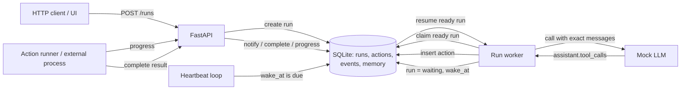
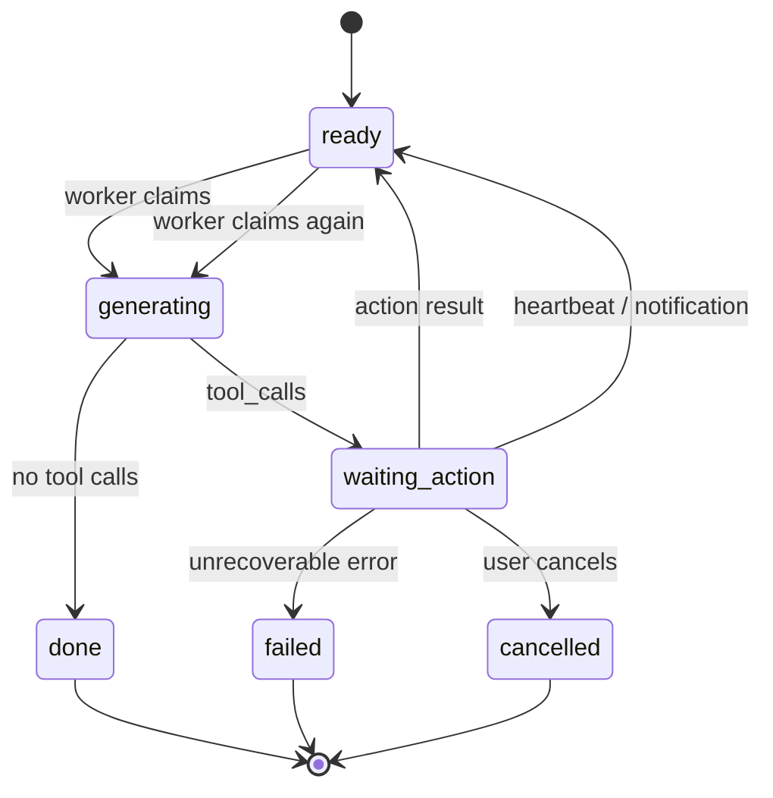

# Architecture

The demo explores one specific problem: an agent must be able to **stop
generating after a tool call**, survive an arbitrarily long tool execution, and
resume from the exact transcript — while still reacting to new events.

It is deliberately small: one process, one SQLite file, one worker and a
deterministic mock model. The interesting part is the run/action/wake protocol,
not the infrastructure.

## Components



### Runtime roles

- **Run** — a resumable generation transcript. It owns `messages`, `status`,
  `pending_calls` and `wake_at`.
- **Action** — a tool execution owned by a run. It has its own lifecycle and
  **no timeout**.
- **Worker** — claims a ready run, calls the model, and then either finishes or
  parks the run in `waiting`. The model can be the deterministic `MockModel`
  (default) or `OpenAIModel` against any OpenAI-compatible chat completions
  endpoint (DeepSeek, OpenAI, etc.). Both consume the same stored transcript.
- **Heartbeat loop** — finds waiting runs whose `wake_at` is due and wakes them.
  This is a timeout of the **wait**, not of the tool.
- **SQLite** — source of truth. The process can restart between steps; the
  transcript and actions are durable.

## Run state machine



The pause is always at a step boundary: after an `assistant.tool_calls` message,
before the next model call. The transcript is never rebuilt from retrieval while
the run is waiting.

## Wake protocol

### Action completes normally

If the call has not received an interim result, append a normal `tool` message:

```text
assistant(tool_calls=[call_1])
tool(call_1, result)
assistant(final)
```

### Heartbeat or notification before the action finishes

An `assistant.tool_calls` message must be followed by a `tool` message, so the
run cannot simply insert a user message. Instead, the same run gets an
**interim tool result** first:

```text
assistant(tool_calls=[call_1])
tool(call_1, {"status":"in_progress","progress":{...}})
system(No new events in the last 1.5s.)
```

The heartbeat text is intentionally generic: it names no tool and no action.
The first heartbeat also gets an interim tool result. Later heartbeats compare a
signature of pending action status/progress with the last wake:

- unchanged: append a `heartbeat_skipped` event, schedule the next wake with
  exponential backoff (capped at 300s), and do **not** call the LLM;
- changed: append a `Progress update: ...` system message when an interim result
  already exists, then the generic heartbeat message and wake the run.

A system message is kept for real wakes because an empty wake can make a model
repeat the last user request and issue the same tool call again. The engine also
ignores a duplicate pending tool call (same tool and args) instead of starting a
second action. This covers a bash-launched server that never returns an exit
code: the action stays `running`, heartbeat does not complete it, and the run
waits for an explicit stop.

For a notification:

```text
assistant(tool_calls=[call_1])
tool(call_1, {"status":"in_progress","progress":{...}})
user(peer ping)
assistant(acknowledgement / progress)
```

The run then parks again in `waiting`. The action keeps running.

### Final result arrives after an interim result

A `call_id` may have only one `tool` result in the protocol. The late final
result is therefore appended as **independent system text**:

```text
assistant(tool_calls=[call_1])
tool(call_1, {"status":"in_progress"})
user(peer ping)
assistant(still working)
system(TOOL RESULT (late): {...})
assistant(final)
```

This is the deliberate trade-off: the model gets the final data, but it is not
represented as a second tool result for the same call.

## Invariants

1. **Exact transcript.** While a run waits for a tool, its `messages` are the
   source of truth and are not reconstructed from retrieval.
2. **Action has no timeout.** `wake_at` belongs to the run's wait, not to the
   action. A tool may run for minutes or hours.
3. **One `tool` message per `call_id`.** Heartbeat/notification adds an interim
   tool message; a later final result is independent `system` text.
4. **Worker never waits on a tool.** The worker only claims ready runs. A single
   long action does not occupy the worker.
5. **Heartbeat does not mutate actions.** It wakes the run, appends an interim
   tool result if needed, and adds only the generic "No new events" system text
   when something changed. Unchanged heartbeats are skipped with backoff.
6. **No duplicate pending action.** If the model repeats the same tool call with
   the same args while it is pending, the engine keeps one action and records
   `duplicate_tool_call_ignored`.
7. **Append-only memory.** `memory` and `events` are read models for UI/debugging;
   old records are not rewritten by compaction.
8. **State is durable.** A restart can recover a run because the transcript,
   pending calls and action rows are persisted before the process yields.

## Non-goals and limits

- No mid-token pause/resume. Standard LLM APIs pause at a step boundary.
- No distributed worker leases. The demo assumes one process.
- No real shell execution. The mock tools make the protocol observable and
  deterministic; the model itself can be a real OpenAI-compatible endpoint via
  `.env`.
- No production auth, tenancy or rate limiting.

## Files

```text
app/store.py   persistence: runs, actions, events, memory
app/engine.py  claim → model → park/resume, heartbeat, notifications
app/model.py   mock or OpenAI-compatible model client
app/tools.py   mock auto/manual/server/fail/multi tools
app/main.py    HTTP API, SSE, UI
bench/         scheduler-level benchmark
tests/         protocol and API tests
```
